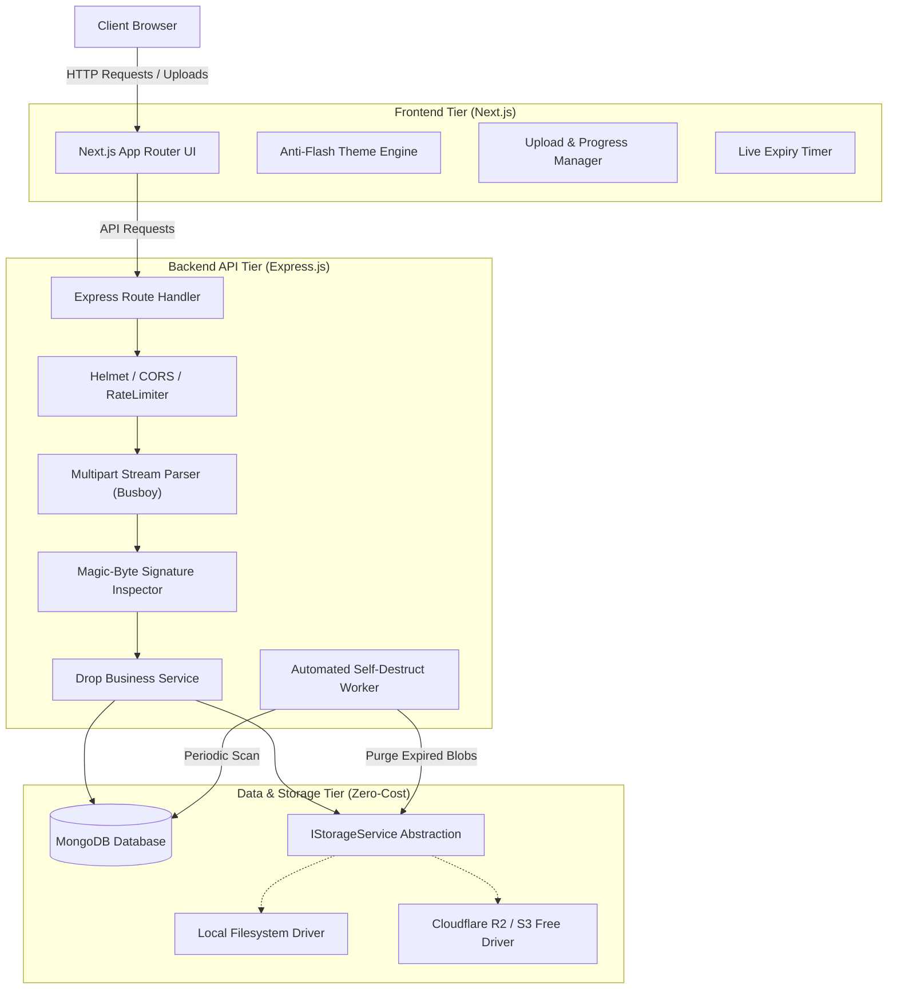
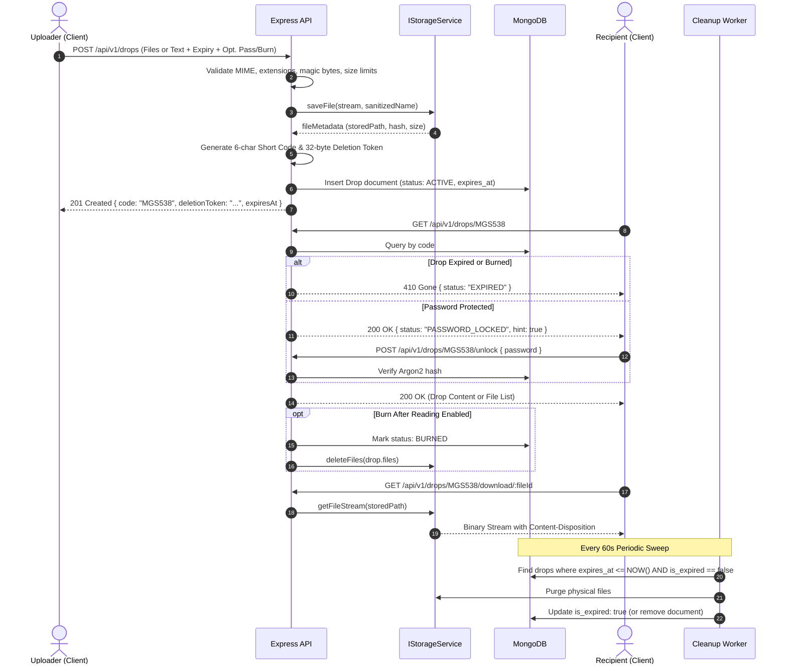

# N1 — System Architecture Document

> **Status:** Specification Phase  
> **Target Version:** 1.0.0  
> **Budget Constraint:** ₹0 (Strictly Free-Tier & Local-First)

---

## 1. High-Level Architecture Overview

N1 follows a decoupled modular monorepo architecture divided into three discrete tiers:

1. **Frontend Tier (`apps/web`):** Next.js with React 19, TypeScript, and Tailwind CSS. Responsible for rendering the dark-first UI, executing client-side anti-flash theme resolution, validating inputs via Zod, managing upload progress, and rendering interactive countdown timers.
2. **Backend API Tier (`apps/api`):** Node.js and Express in TypeScript. Responsible for streaming multipart upload processing, magic-byte file signature validation, cryptographic token generation, rate limiting, and access authorization.
3. **Data & Storage Tier:**
   - **Database:** MongoDB for document persistence and index querying.
   - **File Storage:** Private filesystem (development/self-hosted) or S3-compatible object store (Cloudflare R2 free tier) encapsulated entirely behind an abstract `StorageService`.



---

## 2. The Core Drop Lifecycle

Every Drop adheres to an irreversible, finite lifecycle ensuring no uncollected or expired data lingers:



---

## 3. StorageService Abstraction Pattern

To strictly satisfy the **zero-cost constraint** while remaining production-ready, the backend never directly calls filesystem APIs (`fs`) inside controllers or business logic. All file I/O is governed by the `IStorageService` interface.

### The Interface Contract

```typescript
export interface StoredFileResult {
  storedName: string;
  storageKey: string;
  sizeBytes: number;
  mimeType: string;
  checksumSha256: string;
}

export interface IStorageService {
  /**
   * Streams an incoming file directly to storage destination.
   */
  saveFile(
    fileStream: NodeJS.ReadableStream,
    originalFilename: string,
    mimeType: string
  ): Promise<StoredFileResult>;

  /**
   * Retrieves a readable stream for a stored file key.
   */
  getFileStream(storageKey: string): Promise<NodeJS.ReadableStream>;

  /**
   * Deletes a single file by its storage key.
   */
  deleteFile(storageKey: string): Promise<boolean>;

  /**
   * Bulk deletes an array of storage keys (used during drop cleanup).
   */
  deleteMany(storageKeys: string[]): Promise<{ deletedCount: number }>;

  /**
   * Generates a streaming ZIP bundle of multiple storage keys on-the-fly.
   */
  getZipStream(
    files: Array<{ storageKey: string; originalName: string }>
  ): Promise<NodeJS.ReadableStream>;

  /**
   * Health check verifying storage availability and free space.
   */
  checkHealth(): Promise<{ healthy: boolean; driver: string; details?: string }>;
}
```

### Implementations

1. **`LocalStorageService` (Default / Local / Self-Hosted):**
   - Writes blobs to a configured private host directory (`storage/drops/`) located strictly outside the public web root.
   - Partitions files into subdirectories based on creation date or hash prefix (e.g., `storage/drops/2026-09/`) to avoid single-directory inode degradation.
   - Generates dynamic ZIP bundles using `archiver` piped directly to HTTP response streams to keep memory overhead below 20 MB regardless of file size.
   - **Cost:** ₹0.

2. **`S3CompatibleStorageService` (Cloud / Zero-Egress Production):**
   - Implements the identical interface using the `@aws-sdk/client-s3`.
   - Targets **Cloudflare R2** (Free tier: 10 GB storage, 10M Class B reads/month, **0 egress fees**) or **Backblaze B2** (10 GB free).
   - Swapped simply by toggling `STORAGE_DRIVER=s3` in environment configuration without modifying a single line of application code.
   - **Cost:** ₹0 within free tier limits.

---

## 4. Automated TTL & Self-Destruction Engine

One of the largest risks with temporary sharing platforms is "storage leaking" — files remaining on disk after database records expire. N1 employs a **two-phase deterministic cleanup strategy**:

### Phase A: Database TTL Index

- MongoDB documents feature an `expiresAt` field indexed with a TTL:
  ```typescript
  DropSchema.index({ expiresAt: 1 }, { expireAfterSeconds: 0 });
  ```
- MongoDB's internal background thread marks and drops expired documents automatically.

### Phase B: The Dedicated Cleanup Worker (`CleanupService`)

Because MongoDB TTL removal does not trigger disk file deletion hooks automatically, N1 runs an internal scheduled worker (using standard Node timers or `cron`) every 60 seconds:

1. **Query:** Scans for drops where `expiresAt <= new Date()` AND `isPurged === false`.
2. **Blob Destruction:** Invokes `StorageService.deleteMany(drop.files.map(f => f.storageKey))`.
3. **Database Flagging:** Sets `isPurged = true`, `isExpired = true`, clears `textContent`, and records `purgedAt`.
4. **Retention Window:** Keeps a lightweight tombstone record for 24 hours so visiting recipients see the clean _"This Drop has expired"_ message rather than a confusing 404, before the tombstone itself is deleted.

---

## 5. Frontend Architecture & Design System

The frontend application (`apps/web`) is structured around Next.js App Router, engineered for extreme performance and aesthetics:

### Anti-Flash Theme Engine

To prevent the jarring "white flash" when loading dark-mode pages on client hydration:

- A tiny (~20 lines), zero-dependency vanilla JS script is embedded synchronously at the very top of `<head>`.
- It inspects `localStorage.getItem('n1-theme')` and OS media query `(prefers-color-scheme: light)`.
- It assigns `data-theme="dark"` or `data-theme="light"` to `document.documentElement` **before** the first browser layout or paint occurs.

### Design Tokens & Tailwind Integration

All CSS variables match the original dark-first specifications:

- **Background Canvas:** `#09090F` (Dark) / `#F8F8FC` (Light)
- **Card Surface:** `#111118` (Dark) / `#FFFFFF` (Light)
- **Raised Surface:** `#1A1A26`
- **Overlay Surface:** `#20202E`
- **Borders:** `#1E1E2C` (Subtle) to `#2A2A3C` (Default)
- **Brand Primary:** `#7C3AED` (Electric Purple)
- **Accent Gold:** `#F5C518` (Utility Gold)
- **Text Primary:** `#F0F0F8`
- **Text Secondary:** `#8A8AA8`
- **Text Muted:** `#52526A`

### Layout & Component Hierarchy

- **Floating Pill Navbar:** Glassmorphic bar (`backdrop-filter: blur(14px) saturate(140%)`) floating 14px from viewport top, contracting on scroll.
- **Ambient Background Layer:** Fixed CSS pseudo-elements rendering dual radial glows (violet at top-left, warm amber at top-right) and a 64px faint grid texture.
- **Component Architecture:**
  - `DropZone`: Multi-file drag-and-drop container with keyboard triggers and client-side duplicate deduplication.
  - `ModeToggle`: Tabbed pill switch (`Files` vs `Text`).
  - `ExpiryPicker`: Pill selection matrix (`15m`, `1h`, `6h`, `24h`, `7d`).
  - `CountdownBadge`: Live second-by-second ticker calculating delta against server `expiresAt`.

---

## 6. Zero-Cost Infrastructure & Deployment Mapping

N1 is engineered to deploy across multiple free hosting platforms:

| Component          | Local Dev (₹0)              | Cloud Free Tier (₹0)                   | Self-Hosted VPS (₹0 on existing infra) |
| :----------------- | :-------------------------- | :------------------------------------- | :------------------------------------- |
| **Frontend**       | `localhost:3000`            | Vercel Free Hobby Tier                 | Docker / Nginx reverse proxy           |
| **Backend API**    | `localhost:5000`            | Render Free Web Service / Railway Free | Node.js PM2 process                    |
| **Database**       | Local MongoDB (`mongod`)    | MongoDB Atlas M0 (512 MB Free)         | Local MongoDB on Docker                |
| **Object Storage** | Local `./storage` directory | Cloudflare R2 (10 GB free, $0 egress)  | Local private disk mounted volume      |
| **SSL / CDN**      | Self-signed / none          | Cloudflare Free SSL & CDN              | Let's Encrypt / Certbot                |
| **Cron / Worker**  | Node.js `setInterval`       | In-process timer on Render             | In-process timer / Systemd timer       |

---

## 7. Architectural Decisions Log (ADR)

1. **ADR-001: Separate API Tier vs Next.js Server Actions**
   - _Decision:_ Maintain a dedicated Express.js backend instead of relying solely on Next.js serverless functions.
   - _Rationale:_ Serverless environments (like Vercel) impose strict 4.5 MB request body limits and short execution timeouts (10–15s). Streaming 200 MB multipart uploads and generating dynamic ZIP archives requires long-lived stream pipelines best handled by Express.js.
2. **ADR-002: Monorepo with Shared Validation Package**
   - _Decision:_ Centralize Zod schemas and TypeScript interfaces in `packages/shared`.
   - _Rationale:_ Guarantees that validation rules (max file size, allowed extensions, text limits, expiry presets) cannot drift out of sync between frontend forms and backend controllers.
3. **ADR-003: StorageService Abstraction from Day 1**
   - _Decision:_ Wrap all filesystem interactions behind `IStorageService`.
   - _Rationale:_ Adheres strictly to the ₹0 budget constraint during local development while allowing instantaneous migration to Cloudflare R2 or MinIO without touching business logic.
