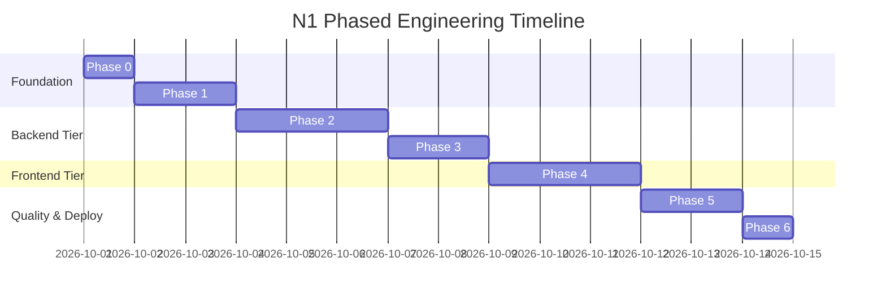

# N1 — Phased Development & Testing Roadmap

> **Status:** Roadmap Approved  
> **Budget Constraint:** Exactly ₹0  
> **Rule:** Strict gated progression — no phase starts until previous phase tests pass.

---

## 1. Development Phases Overview

---

## 2. Phase-by-Phase Execution Details

### Phase 0: Specifications & Monorepo Tooling (Current Status: COMPLETE)

- **Deliverables:**
  - `README.md`, `ARCHITECTURE.md`, `PRODUCT_SPEC.md`, `SECURITY.md`, `API_SPEC.md`, `DEVELOPMENT_PLAN.md`, `.env.example`, `.gitignore`.
  - Define strict ₹0 architectural boundaries.
- **Exit Gate:** All core architecture documents created, reviewed, and aligned.

---

### Phase 1: Shared Core & Storage Engine Abstraction

- **Focus:** Build the runtime-agnostic validation layer and private storage drivers.
- **Key Tasks:**
  1. Initialize `packages/shared`:
     - Define Zod schemas for drop creation, passphrase unlocking, and query params.
     - Define TypeScript interfaces (`DropEntity`, `StoredFile`, `ApiEnvelope`).
     - Export canonical constants (`ALLOWED_EXTENSIONS`, `EXPIRY_PRESETS`, `MAX_FILE_SIZE`).
  2. Implement `IStorageService` in `apps/api`:
     - Implement `LocalStorageService` targeting private directory outside web root.
     - Implement multipart streaming file writer with atomic byte counting.
     - Implement `MagicByteValidator` using `file-type` to inspect the initial 4KB buffer.
     - Implement on-the-fly streaming ZIP generator via `archiver`.
- **Exit Gate (Verification):**
  - Vitest unit tests verifying that magic-byte validator correctly identifies PNG, JPG, PDF, ZIP, and rejects disguised executables.
  - Local storage tests confirming file creation, retrieval stream, and deletion.

---

### Phase 2: Express Backend API & MongoDB Models

- **Focus:** Build database persistence, controller logic, and REST endpoints.
- **Key Tasks:**
  1. Define Mongoose schemas in `apps/api/src/models`:
     - `DropSchema` (code, type, textContent, files, totalSizeBytes, expiresAt, deletionTokenHash, passwordHash, burnAfterReading, maxViews, viewCount, isExpired).
     - TTL index on `expiresAt`.
  2. Implement `DropService`:
     - Short code generator using `crypto.randomBytes` with collision retry loop.
     - Argon2id hashing for password-protected drops.
     - Atomic view decrementing and burn-after-reading transitions.
  3. Implement Controllers & Routes:
     - `POST /api/v1/drops` (streaming busboy upload handler).
     - `GET /api/v1/drops/:code` (metadata and content fetch).
     - `POST /api/v1/drops/:code/unlock` (passphrase verification).
     - `GET /api/v1/drops/:code/download/:fileId` (single file stream).
     - `GET /api/v1/drops/:code/download-all` (streaming ZIP bundle).
     - `DELETE /api/v1/drops/:code` (owner deletion token check).
- **Exit Gate (Verification):**
  - Supertest integration tests verifying end-to-end drop creation, retrieval, password unlocking, file download streams, and deletion.

---

### Phase 3: Expiration Worker & Security Hardening

- **Focus:** Implement automated self-destruct worker and HTTP security shields.
- **Key Tasks:**
  1. Implement `CleanupService`:
     - Background interval running every 60 seconds.
     - Queries database for expired drops (`expiresAt <= NOW()`).
     - Calls `StorageService.deleteMany()` to unlink physical files.
     - Marks drops as purged / writes 24h tombstone record.
  2. Security Middleware Integration:
     - Configure Helmet with strict CSP and headers.
     - Configure CORS restricted to frontend domain.
     - Implement tiered rate limiting with `express-rate-limit`.
     - Add global error handling middleware ensuring zero stack-trace leakage.
- **Exit Gate (Verification):**
  - Automated worker tests: Seed expired drops and verify that files on disk are physically unlinked and DB documents updated within 60s.
  - Rate-limiting integration tests verifying `429 Too Many Requests` triggers accurately.

---

### Phase 4: Next.js Frontend & Design System

- **Focus:** High-aesthetic, responsive, dark-first UI implementation in Next.js App Router.
- **Key Tasks:**
  1. Setup Design System & Theme Engine:
     - Configure Tailwind with exact color tokens (`#09090F`, `#111118`, `#7C3AED`, etc.).
     - Embed the synchronous anti-flash script in `app/layout.tsx`.
     - Build the floating pill navbar with glassmorphic blur and scroll compression.
     - Implement ambient canvas glows and subtle 64px background grid texture.
  2. Build Core Views:
     - **Upload Screen (`/drop`):** Drag-and-drop zone, file queue with delete buttons, text mode with character counter, expiry pills, upload progress bar.
     - **Success Screen (`/drop/success/[code]`):** Monospace 6-character code, one-click copy with toast notification, expiry badge, QR code generator.
     - **Recipient View (`/d/[code]`):** File download cards, individual download triggers, "Download All (ZIP)" button, text copy box, live countdown timer.
     - **Expired Screen:** Clean state card explaining auto-destruction with a button to create a new Drop.
- **Exit Gate (Verification):**
  - Zero-flash theme toggle across light, dark, and system modes.
  - Responsive layout verified across mobile (375px), tablet (768px), and desktop (1440px).

---

### Phase 5: Comprehensive Automated Testing Suite

- **Focus:** Full test coverage across unit, integration, and E2E layers.
- **Testing Matrix:**
  - **Unit Tests (Vitest):**
    - Short code collision avoidance and entropy validation.
    - Argon2 password hashing and timing-safe comparison.
    - Magic-byte inspection across valid and corrupted file buffers.
    - Storage service disk write, stream, and delete operations.
  - **API Tests (Supertest):**
    - Multi-file upload under 200 MB aggregate.
    - Rejection of files $> 50$ MB with `413 Payload Too Large`.
    - Rejection of disallowed extensions with `400 Bad Request`.
    - Password challenge and unlock flow.
    - Owner deletion token verification and unauthorized deletion rejection.
  - **E2E Tests (Playwright):**
    - Complete user flow: Drag-and-drop upload -> Success page -> Copy link -> Open recipient page -> Download file.
    - Burn-after-reading user flow: Open link -> Verify content -> Refresh page -> Verify `410 Expired` state renders.
- **Exit Gate (Verification):**
  - 100% test pass rate across all suites before deployment staging.

---

### Phase 6: Production Readiness & Zero-Cost Deployment

- **Focus:** Packaging, containerization, and free-tier infrastructure verification.
- **Key Tasks:**
  1. Multi-stage `Dockerfile` and `docker-compose.yml` for unified local or VPS execution.
  2. Configure deployment options:
     - Option A (All-in-one VPS / Self-hosted): Nginx reverse proxy + Node.js + MongoDB on local disk.
     - Option B (Cloud Free Tier): Next.js on Vercel Hobby + Express on Render Web Service + MongoDB Atlas M0 + Cloudflare R2 (10 GB free).
- **Exit Gate (Verification):**
  - Zero-cost deployment verified live on free tiers without any credit card or paid resource requirement.

---

## 3. Future Modules Roadmap (Post-v1.0)

1. **Toolbox (`/tools`):**
   - Implement pure client-side tools using Web Workers (JSON formatter, image compressor, PDF compiler, UUID generator).
2. **Study Board (`/board`):**
   - Integrate an HTML5 Canvas / SVG whiteboard engine with academic templates and WebSocket ephemeral rooms.
3. **Duel (`/duel`):**
   - Implement real-time 1v1 matchmaker and synchronized 60-second quiz engine over WebSockets.
4. **Admin & Moderation (`/admin`):**
   - Hash blacklisting engine and automated abuse reporting pipeline.
