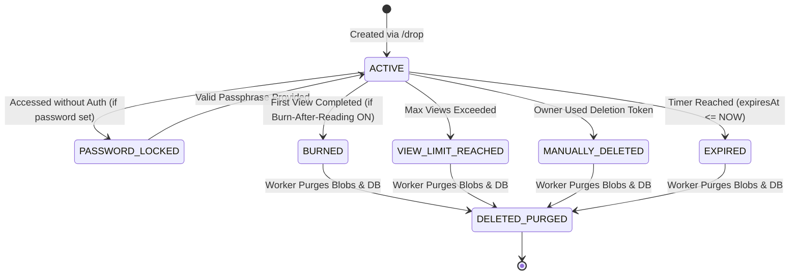

# N1 — Complete Product Specification

> **Status:** Approved Specification  
> **Platform Name:** N1  
> **Primary Module:** Drop  
> **Budget Constraint:** ₹0 (Strictly Free-Tier & Local-First)

---

## 1. Product Vision & Positioning

**N1** is a high-speed, privacy-first, zero-friction web platform built for creators, students, and professionals who need to share digital assets and collaborate without surrendering personal identity.

### Target User Personas

- **The Privacy-Conscious Professional:** Needs to transmit sensitive logs, credentials, or mockups to a client without leaving permanent cloud storage traces.
- **The University Student:** Needs to share class notes, PDF slides, or ER diagrams without creating accounts on third-party cloud drives.
- **The Developer:** Needs a fast, command-line or browser-friendly text drop and toolbox for quick JSON formatting, Base64 operations, and UUID generation.

### Core Value Pillars

1. **Zero Registration:** No accounts, no email verification, no OAuth redirects, no session cookies.
2. **Deterministic Expiration:** Every asset has an immutable expiration time after which it is destroyed permanently.
3. **High Aesthetics & Polish:** Dark-first aesthetic, fluid micro-animations, glassmorphic floating bars, and responsive typography that feels premium.
4. **Zero-Cost Sustainability:** Operates entirely within free-tier computational and storage envelopes.

---

## 2. Flagship Module: "Drop"

"Drop" is the core anonymous file and text sharing engine of N1.

### 2.1 File & Content Constraints

| Parameter                   | Limit                                                                                                       | Enforcement Mechanism                                        |
| :-------------------------- | :---------------------------------------------------------------------------------------------------------- | :----------------------------------------------------------- |
| **Max Files per Drop**      | 10 files                                                                                                    | Client check + Server multipart file stream limiter          |
| **Max File Size**           | 50 MB per file                                                                                              | Busboy stream byte counter with instant abort                |
| **Max Total Drop Size**     | 200 MB aggregate                                                                                            | Running byte accumulator across all parts                    |
| **Max Text Size**           | 10,000 characters                                                                                           | Client textarea limiter + Server Zod schema                  |
| **Allowed File Extensions** | `.jpg`, `.jpeg`, `.png`, `.webp`, `.pdf`, `.doc`, `.docx`, `.xls`, `.xlsx`, `.ppt`, `.pptx`, `.txt`, `.zip` | Whitelist check on extension + MIME + Magic Bytes            |
| **Short Code Length**       | 6 characters (Alphanumeric uppercase, e.g., `MU96Z8`)                                                       | Cryptographic random generation (~56.8 billion combinations) |
| **Expiration Presets**      | `15m`, `1h`, `6h`, `24h`, `7d`                                                                              | Server-calculated UTC ISO timestamp                          |

---

### 2.2 Advanced Drop Capabilities

#### A. Secure Owner Deletion Token

- Upon drop creation, the server generates a 32-byte cryptographically secure random token (`deletionToken`).
- This token is returned **exclusively** to the uploader in the creation response and stored in the uploader's browser `localStorage` as proof of ownership.
- The uploader can navigate to `/drop/success/{CODE}` or `/d/{CODE}` and trigger an instantaneous early deletion, purging files and data immediately without waiting for the timer.

#### B. Password Protection

- Uploaders can optionally supply a passphrase.
- The server hashes the passphrase using **Argon2id** (or bcrypt) with an unpredictable salt before storing.
- When a recipient visits `/d/{CODE}`, content is withheld. The server presents a `PASSWORD_LOCKED` challenge. Upon submitting the correct passphrase, a signed temporary access token (or secure session cookie) is issued to authorize viewing and downloads.

#### C. View Limits & Burn-After-Reading

- **Burn-After-Reading:** If toggled ON, the Drop is permanently scheduled for destruction immediately after its first successful view.
- **Configurable Max Views:** Uploaders can limit the drop to $N$ total views (e.g., 1, 5, 10 views). An atomic counter decrements upon each unique viewing session. Once zero is reached, the Drop transitions to `EXPIRED`.

#### D. Dynamic ZIP Packaging

- When a Drop contains multiple files, the recipient interface displays a **"Download All (ZIP)"** button.
- Rather than pre-compressing files onto disk (wasting storage space), the backend streams files through `archiver` directly into the HTTP response with zero intermediate disk caching.

#### E. QR Code Generation

- Integrated vector QR code rendering directly on both the Success screen and Recipient screen, enabling frictionless screen-to-mobile transmission.

---

### 2.3 Drop Lifecycle & State Machine



---

### 2.4 User Experience & Page Route Specifications

#### 1. Creation Page: `/drop`

- **Header / Eyebrow:** Badge labeled `Quably Drop / N1 Drop` with cloud icon.
- **Mode Toggle:** Segmented pill button toggling between **"Files"** and **"Text"**.
- **Files View:**
  - Drag-and-drop zone with animated dashed borders that highlight on drag-over.
  - Selected file queue showing file name, formatted size (`KB`/`MB`), extension tag, and remove button.
  - Aggregate size status indicator (e.g., `3 files · 14.2 MB / 200 MB`).
- **Text View:**
  - Clean dark monospace textarea with placeholder _"Paste or type anything here…"_.
  - Live character counter with warning states (turns yellow at 8,000, red at 9,500).
- **Options Section:**
  - **Expiry Pills:** Clickable pill selector with active states (`15 minutes`, `1 hour`, `6 hours`, `24 hours`, `7 days`).
  - **Security Accordion (Optional):** Expandable drawer to enter optional Password, set Max Views, or toggle Burn-After-Reading.
- **Submission:** Primary button _"Create Drop"_. Triggers an XHR upload with progress bar showing `0%` to `100%` before auto-redirecting.

#### 2. Success Page: `/drop/success/{CODE}`

- **Hero Confirmation:** Green circular success checkmark badge.
- **Short Code Display:** Large monospace container displaying the 6-character code (e.g., `MGS538`) and full canonical URL (`https://domain/d/MGS538`).
- **Primary Actions:**
  - _"Copy Link"_ button with instant animated feedback (`Copied!`).
  - _"View Drop Page"_ ghost button.
  - _"Create Another Drop"_ subtle button.
  - _"Delete Drop Now"_ dangerous action button (validated via stored owner deletion token).
- **Expiry Badge:** Pill displaying real-time countdown to scheduled expiration.

#### 3. Recipient View Page: `/d/{CODE}`

- **Header:** Displays drop type (Text Drop or File Drop), code badge, and dynamic live countdown timer.
- **If Text Mode:** Clean preformatted container with line breaks preserved, horizontal scroll on overflow, and a dedicated _"Copy Text"_ button.
- **If File Mode:** Clean card list of each attached file with its icon, name, file size, extension tag, and individual _"Download"_ button. Prominent _"Download All (ZIP)"_ header button when $\ge 2$ files.
- **Tombstone / Expired State:** If visited after expiration, renders an alert card with warning icon:
  - Title: _"This Drop has expired"_
  - Message: _"The content was automatically deleted after the expiry time. Drops are temporary by design."_
  - Action: _"Create a new Drop"_ button.

---

## 3. Future Platform Modules

To ensure high architectural cohesion, N1's foundation is built to accommodate four secondary modules:

### Module 2: The Browser Toolbox (`/tools`)

- **Philosophy:** 100% client-side privacy tools that never send data over the wire.
- **Categories & Tools:**
  - **Developer Tools:** JSON Formatter & Minifier, Base64 Encoder/Decoder, URL Component Encoder, UUID v4 Generator.
  - **Text Tools:** Word & Character Counter, Case Converter (snake_case, camelCase, kebab-case, UPPERCASE), Duplicate Line Stripper, Whitespace Cleaner.
  - **Calculators:** GST Calculator (Indian slabs 5%, 12%, 18%, 28%), EMI Calculator with loan amortization breakdown, Percentage Calculator, Age Calculator.
  - **Image & Document:** Browser-based JPG to PDF compiler (via PDF-Lib), Canvas-based Image Compressor & Resizer, JPG to PNG Converter, Custom Vector QR Code Styler.

### Module 3: Study Board (`/board`)

- **Philosophy:** Real-time visual collaboration for students and remote study sessions with zero account creation.
- **Core Capabilities:**
  - Vector canvas supporting freehand drawing, geometric shapes, text boxes, and sticky notes.
  - **Curated Academic Templates:** Mindmap, Flowchart, DBMS / ER Diagram, Mathematics graph grid, Exam Revision summary, and Group Study scratchpad.
  - Ephemeral sharing via unique 6-character room codes.
  - Local recovery: Boards cached in browser `localStorage` for device continuity.

### Module 4: Duel (`/duel`)

- **Philosophy:** High-intensity 60-second 1v1 technical knowledge battles.
- **Mechanics:**
  - Creator picks a subject (JavaScript, Python, Java, SQL, CS Fundamentals, Logical Reasoning) and difficulty.
  - Creator shares a 1v1 battle link. Opponent clicks link and enters the lobby.
  - Both players lock in "Ready". A 60-second synchronized timer initiates over WebSockets.
  - Both contestants receive identical questions. The player with the highest score at $t=0$ wins.
  - Real-time score ticker and post-match victory card with rematch capabilities.

### Module 5: Admin & Moderation (`/admin`)

- **Philosophy:** Zero-knowledge compliance and platform safety.
- **Capabilities:**
  - Cryptographic SHA-256 Content Hash Blacklist (prevents re-upload of flagged malicious content).
  - Automated Virus/Malware Signature Inspection hook (ClamAV integration or hash matching).
  - Rate-limit analytics and IP throttling dashboard.
  - DMCA Takedown and manual deletion portal.

---

## 4. Design System & Visual Specification

N1 follows a strict dark-first design token specification:

### 4.1 Color Tokens

```css
:root,
[data-theme='dark'] {
  --color-bg: #09090f;
  --color-surface: #111118;
  --color-surface-raised: #1a1a26;
  --color-surface-overlay: #20202e;
  --color-border: #2a2a3c;
  --color-border-subtle: #1e1e2c;

  --color-text-primary: #f0f0f8;
  --color-text-secondary: #8a8aa8;
  --color-text-muted: #52526a;

  --color-purple: #7c3aed;
  --color-purple-light: #9d5ff5;
  --color-purple-dim: rgba(124, 58, 237, 0.12);
  --color-purple-glow: rgba(124, 58, 237, 0.18);
  --color-purple-border: rgba(124, 58, 237, 0.3);

  --color-yellow: #f5c518;
  --color-yellow-light: #ffd740;
  --color-yellow-dim: rgba(245, 197, 24, 0.12);

  --color-success: #22c55e;
  --color-error: #ef4444;
  --color-warning: #f59e0b;
}

[data-theme='light'] {
  --color-bg: #f8f8fc;
  --color-surface: #ffffff;
  --color-surface-raised: #f0f0f8;
  --color-surface-overlay: #e8e8f4;
  --color-border: #d8d8ec;
  --color-border-subtle: #e4e4f4;

  --color-text-primary: #0f0f1a;
  --color-text-secondary: #4a4a6a;
  --color-text-muted: #8a8aaa;
}
```

### 4.2 Typography

- **Wordmark & Headings:** `Satoshi`, `Inter`, -apple-system, sans-serif. Tight tracking (`-0.03em`), bold weights (`700`, `800`).
- **UI & Body:** `Inter`, system-ui, sans-serif. High legibility, 1.5 line height.
- **Code & Expiry Badges:** `JetBrains Mono`, `Fira Code`, monospace.

### 4.3 Visual Micro-interactions

- **Floating Pill Navbar:** Centered pill container with `backdrop-filter: blur(14px) saturate(140%)`. Height 60px, radius 9999px. Contracts to 940px width on scroll.
- **Ambient Canvas:** Dual radial color blooms (purple at top-left, warm amber at top-right) layered beneath a 64px faint grid texture with radial gradient falloff mask.
- **Theme Switching:** Anti-flash client bootstrap with smooth CSS transitions on color and surface tokens (`220ms ease`).
