# ⚡ N1 — Privacy-First Temporary Sharing & Anonymous Productivity Platform

<div align="center">

[](https://n1-pi-eight.vercel.app)
[](https://n1-api.onrender.com/health)
[](https://github.com/Thanniru-yaswanth03/N1)

<br/>


<br/>

### **Zero Accounts. Zero Tracking. Zero Permanent Retention. ₹0 Budget Guaranteed.**

A production-grade, privacy-first web ecosystem combining self-destructing file & text drops, real-time collaborative whiteboards, competitive technical duels, and 30+ client-side developer utilities.

[Explore Live Web App](https://n1-pi-eight.vercel.app) • [API Endpoint](https://n1-api.onrender.com/health) • [Deployment Guide](#-zero-cost-production-deployment) • [Documentation](#-documentation-index)

</div>

---

## 📸 Platform Showcase

<div align="center">
  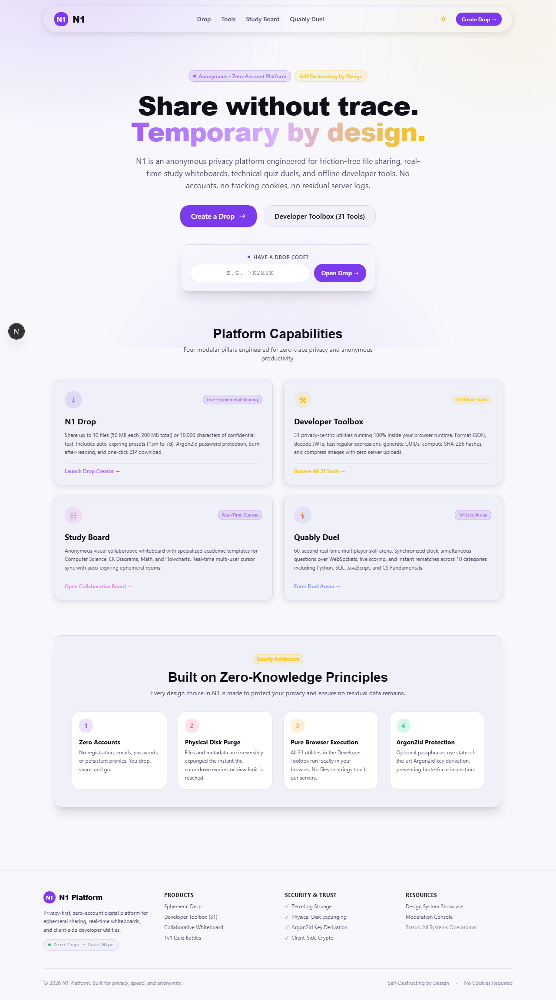
  <p><em>The N1 cyber-minimalist portal — instantaneous access to Ephemeral Drops, Collaborative Whiteboards, 1v1 Duels, and Browser Utilities without creating an account.</em></p>
</div>

<br/>

<div align="center">
  <table width="100%">
    <tr>
      <td width="50%" align="center">
        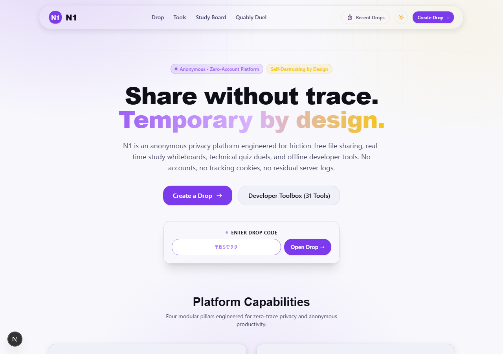
        <br/><strong>Instant Drop Code Retrieval (`/d/{CODE}`)</strong>
      </td>
      <td width="50%" align="center">
        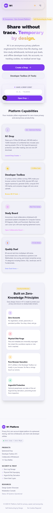
        <br/><strong>Fully Responsive Mobile Layout</strong>
      </td>
    </tr>
  </table>
</div>

---

## 🌟 Core Value Pillars

| Pillar | How N1 Implements It |
| :--- | :--- |
| **🚫 Zero Accounts** | No email signups, no phone numbers, no Google OAuth, and zero persistent user profiles. Visitors use features immediately with 100% anonymity. |
| **⏳ Strict Self-Destruction** | Every upload and room carries a mandatory lifecycle timer (15 mins to 7 days). An automated background worker irreversibly purges files from disk and wipes database metadata upon expiry. |
| **🛡️ Deep-Defense Security** | Magic-byte binary verification, Argon2id + pepper password hashing, cryptographic owner deletion tokens, and salted SHA-256 IP hashing with zero plain-text IP logging. |
| **💸 ₹0 / $0 Free Architecture** | Engineered from ground up to deploy 100% free forever on Vercel Hobby, Render Web Services, and MongoDB Atlas M0 without paid third-party dependencies. |
| **⚡ 100% Client-Side Privacy Tools** | 30+ developer utilities run purely inside the browser using Web APIs (Canvas, Web Crypto, Web Workers). Not a single byte of your data is ever transmitted to a server. |

---

## 📦 Comprehensive Feature Breakdown

### 1. The Ephemeral Drop Engine (Secure Temporary Sharing)

The flagship engine for exchanging sensitive files, credentials, logs, and code snippets with zero data footprint.

<div align="center">
  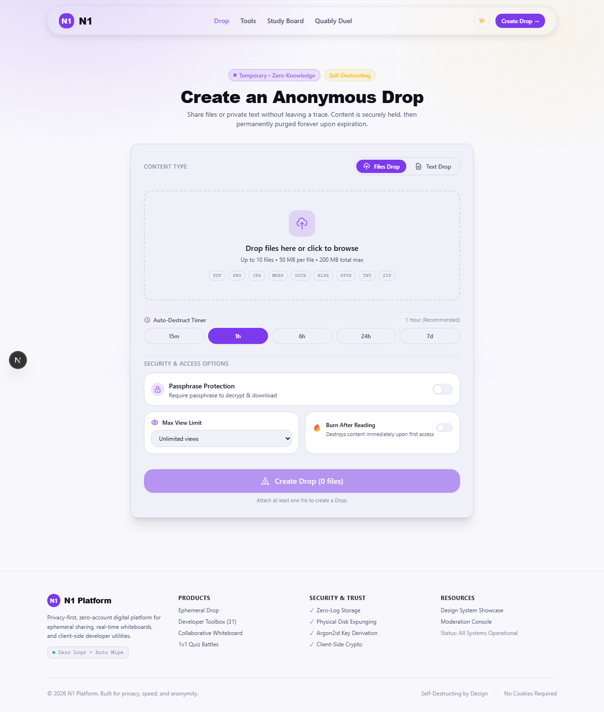
  <p><em>Drop Creation Engine supporting dual File & Text modes, password protection, and live expiration presets.</em></p>
</div>

#### Key Capabilities:
- **Dual Sharing Modes:**
  - **File Mode:** Upload up to 10 files per drop (up to 50 MB per file, 200 MB total) with real-time percentage progress indicators.
  - **Text Mode:** Share sensitive code snippets, keys, or Markdown notes (up to 10,000 characters) with syntax formatting and one-click copy.
- **Strict Expiration Presets:** Choose lifespans of `15 Minutes`, `1 Hour`, `6 Hours`, `24 Hours`, or `7 Days` with live second-by-second countdown urgency cards.
- **Burn-After-Reading:** Automatically deletes the drop and purges disk storage immediately after the recipient's first successful view.
- **Argon2id Password Protection:** Optional password locks protected by Argon2id key derivation + server-side peppers. Unlocking issues a short-lived, scoped JWT token (`x-unlock-token`) to prevent unauthorized hotlinking.
- **Cryptographic Owner Deletion Token:** The drop creator receives a private secret token enabling instant voluntary purging from any device prior to scheduled expiration.
- **Multi-File Streaming ZIP:** Recipients can download files individually or stream an on-the-fly multi-file `.zip` archive generated in memory via Node.js streams without consuming server disk.
- **High-Contrast QR Code:** Instant scan-to-mobile QR codes for frictionless desktop-to-smartphone transfer.

<div align="center">
  <table width="100%">
    <tr>
      <td width="33%" align="center">
        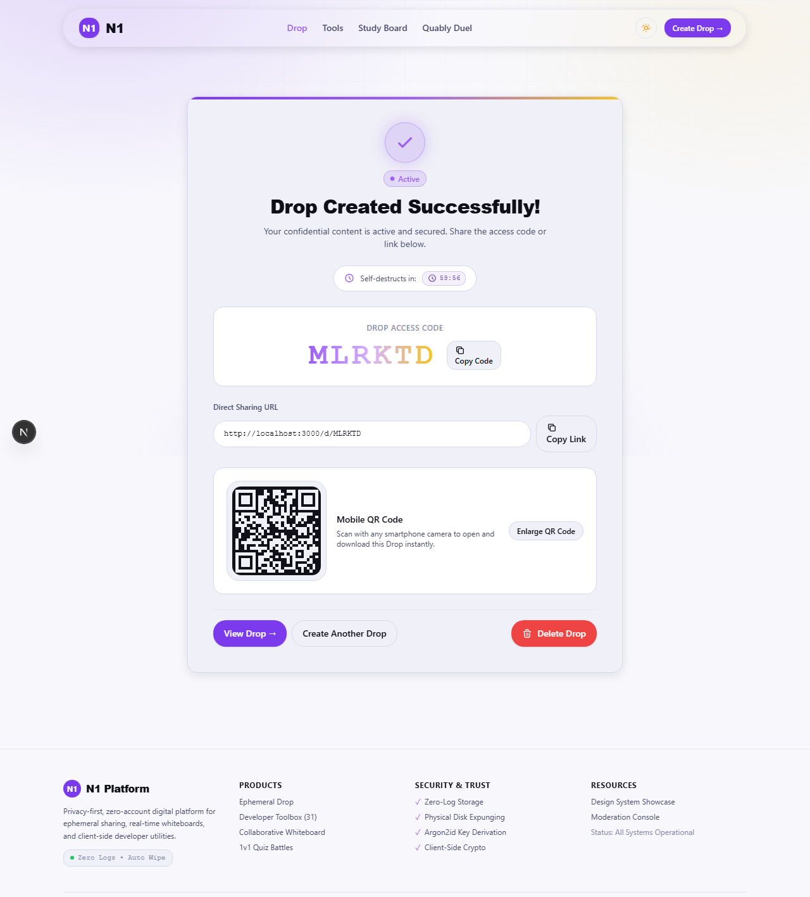
        <br/><strong>Drop Created Screen</strong><br/><em>Share URL, 6-char code & QR</em>
      </td>
      <td width="33%" align="center">
        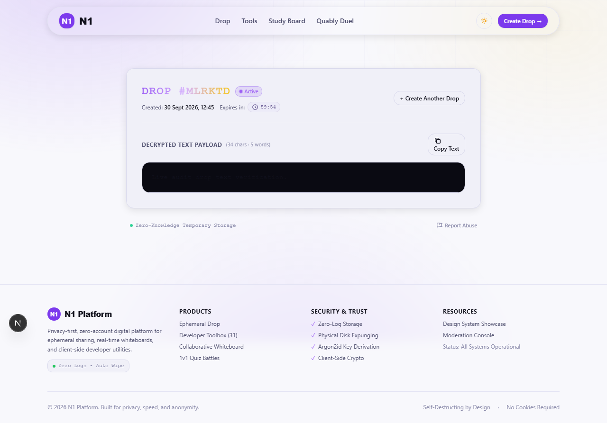
        <br/><strong>Recipient Download Portal</strong><br/><em>Single file & multi-file ZIP stream</em>
      </td>
      <td width="33%" align="center">
        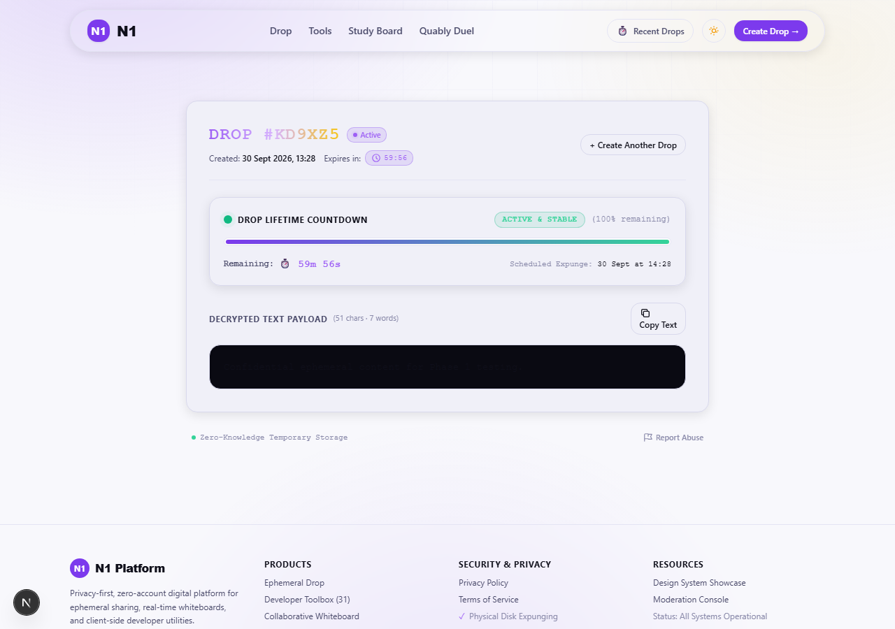
        <br/><strong>Live Urgency Card</strong><br/><em>Second-by-second TTL countdown</em>
      </td>
    </tr>
  </table>
</div>

---

### 2. Study Board (Real-Time Collaborative Whiteboard)

A zero-latency, anonymous collaborative canvas built on persistent WebSockets (`/ws/board`) for study groups, system design sessions, and technical brainstorming.

<div align="center">
  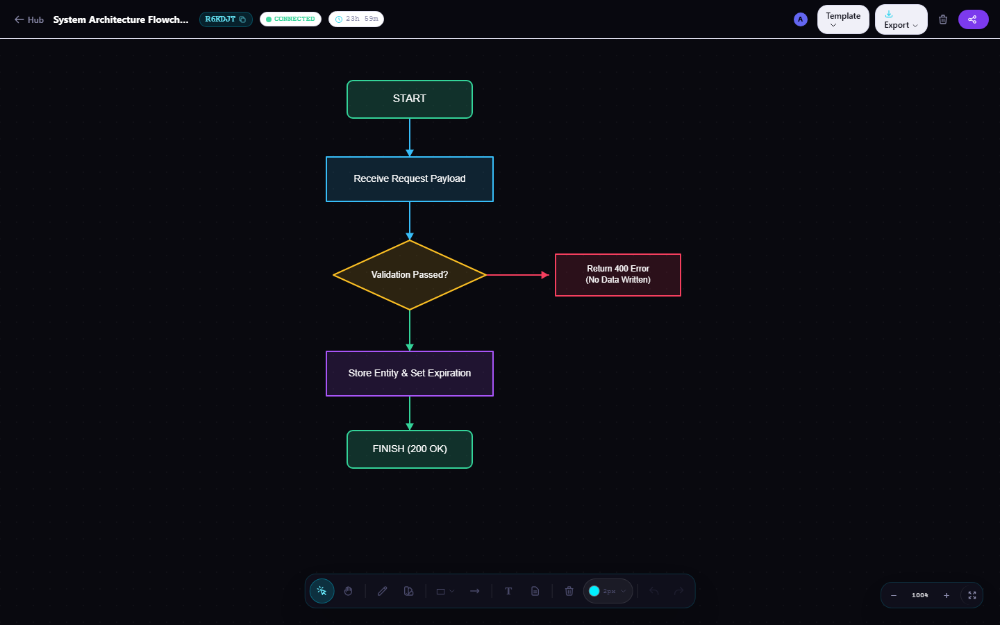
  <p><em>Collaborative canvas with instant shape rendering, sticky notes, text editing, and live multiplayer synchronization.</em></p>
</div>

#### Key Capabilities:
- **Instant Rooms & Zero Logins:** Create or join via 6-character room codes (`/board/{CODE}`). Visitors are automatically assigned colorful anonymous animal handles (e.g. *Anonymous Falcon*, *Anonymous Lynx*).
- **Multiplayer State Sync:** Low-latency WebSocket broadcasting synchronizes live cursor pointers, element creation, movement, editing, and deletion across all connected peers.
- **Comprehensive Vector Drawing Tools:**
  - Freehand Pen with smooth quadratic bezier curves and variable thickness.
  - Rectangles, Circles, Ellipses, Arrows, and Dynamic Connection Lines.
  - In-place canvas Text editing and colorful Sticky Notes.
  - Element Eraser with visual hover highlights.
- **Curated Architecture Templates:** One-click template loaders for **Flowcharts**, **System Design Blocks**, **Binary Trees**, and **Coordinate Grids**.
- **Vector & Raster Exports:** Export the full board to **PNG Image**, **SVG Vector**, or **JSON Element Data** for local backup.
- **24-Hour Automated Room Expiry:** Rooms persist across browser refreshes via MongoDB snapshots and automatically expunge 24 hours after creation.

<div align="center">
  <table width="100%">
    <tr>
      <td width="50%" align="center">
        
        <br/><strong>Client A View</strong><br/><em>Live cursor tracking & drawing</em>
      </td>
      <td width="50%" align="center">
        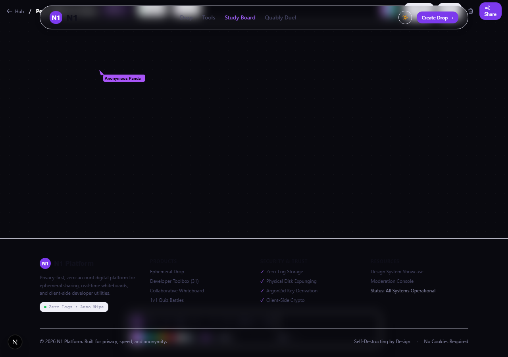
        <br/><strong>Client B View</strong><br/><em>Synchronized in real-time across peers</em>
      </td>
    </tr>
  </table>
</div>

---

### 3. Quably Duel (Real-Time 1v1 Technical Arena)

A competitive, timed 1v1 quiz arena built over WebSockets (`/ws/duel`) to test technical skills in fast-paced head-to-head battles.

<div align="center">
  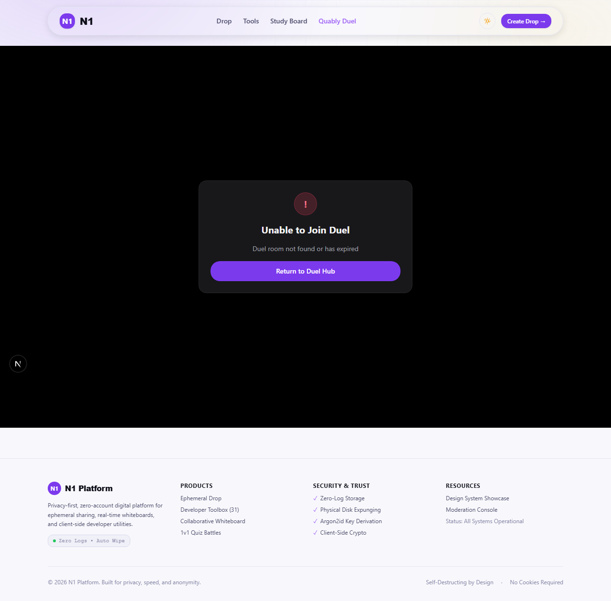
  <p><em>Real-time head-to-head technical battle with live synchronized clocks and opponent progress streaming.</em></p>
</div>

#### Key Capabilities:
- **Instant Matchmaking & Private Rooms:** Jump into a global matchmaking queue or create a private room code for direct peer invites.
- **Authoritative Server Clock:** A synchronized 60-second countdown runs authoritatively on the backend server to eliminate client clock manipulation or score fraud.
- **Live Opponent Progress:** Real-time WebSocket streaming of your opponent's question progress and current score bar.
- **Dynamic Question Pool:** Randomized technical multiple-choice questions spanning **Data Structures**, **Algorithms**, **Web Fundamentals**, and **Logic Puzzles**.
- **Speed Bonus Scoring:** Correct answers earn baseline points plus dynamic bonus points based on answering speed.
- **Disconnection Handling & Rematch:** 15-second grace period for unexpected disconnections, followed by end-game result breakdown and one-click rematch requests.

<div align="center">
  <table width="100%">
    <tr>
      <td width="50%" align="center">
        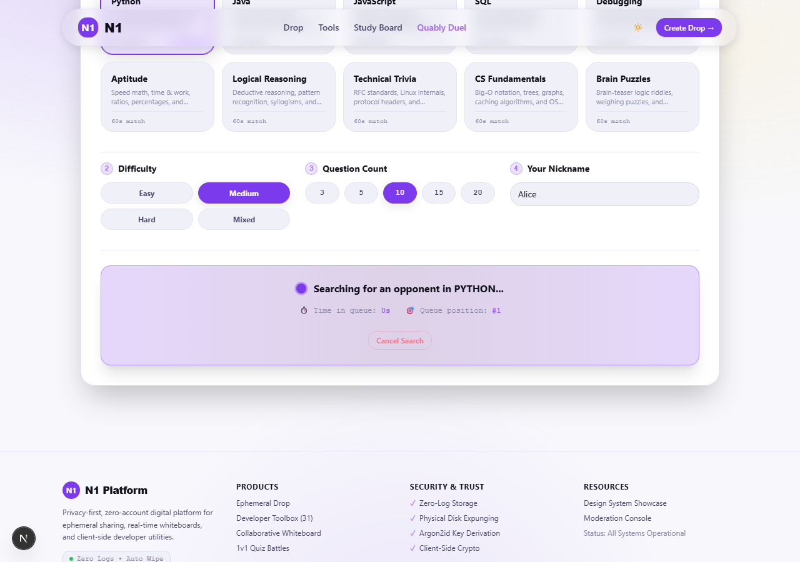
        <br/><strong>Matchmaking Queue</strong><br/><em>Instant peer pairing</em>
      </td>
      <td width="50%" align="center">
        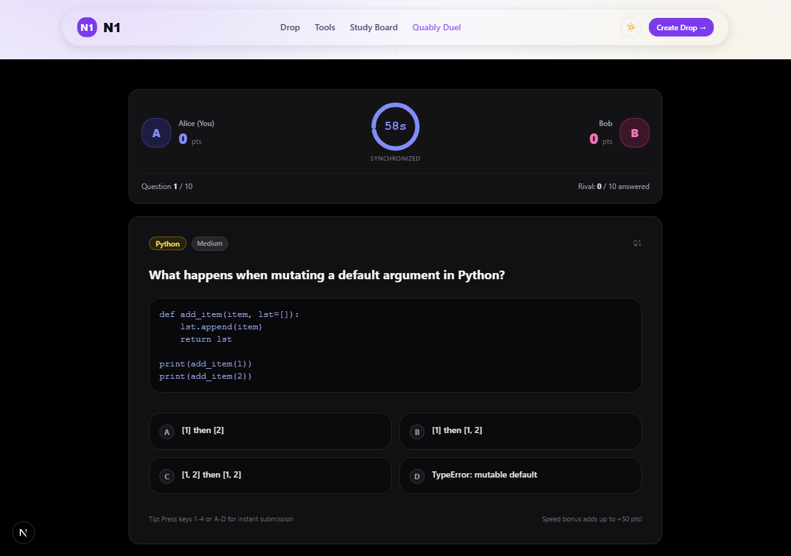
        <br/><strong>Match Found!</strong><br/><em>Synchronized pre-round countdown</em>
      </td>
    </tr>
  </table>
</div>

---

### 4. Developer & Productivity Toolbox (30+ Local Browser Tools)

A complete offline-first suite of **31 utilities** located at `/tools`. **100% runs inside the browser via client-side Web APIs — zero server data transmission.**

<div align="center">
  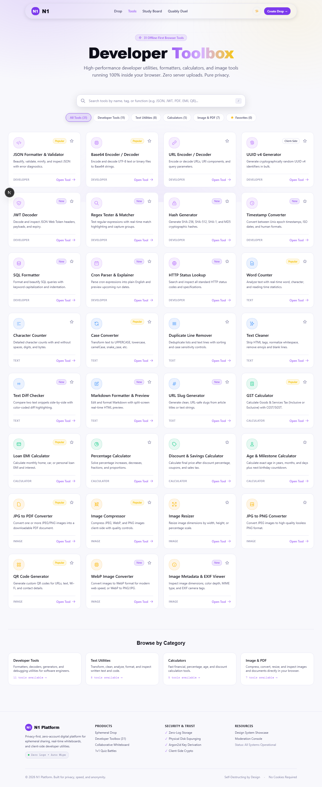
  <p><em>The full 30+ browser utilities suite — categorized, searchable, and running 100% locally on your machine.</em></p>
</div>

<div align="center">
  <table width="100%">
    <tr>
      <td width="25%" align="center">
        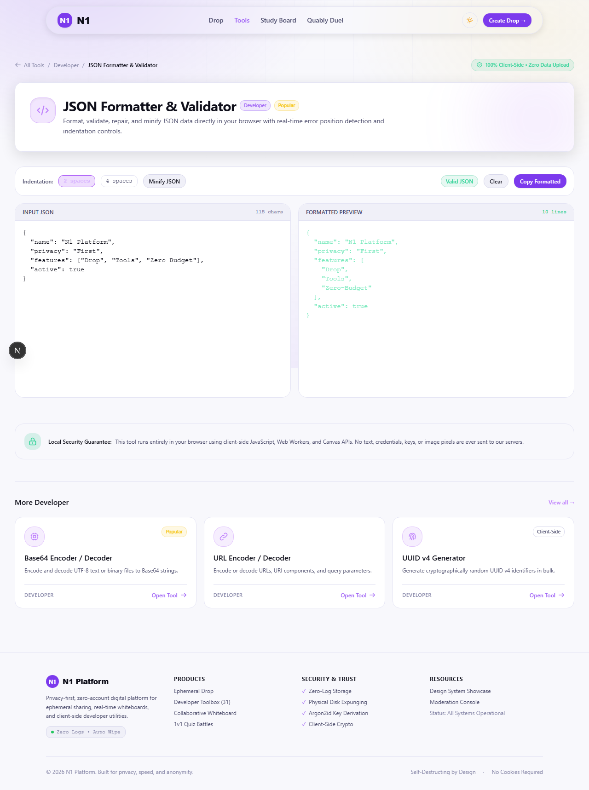
        <br/><strong>JSON Formatter & Validator</strong>
      </td>
      <td width="25%" align="center">
        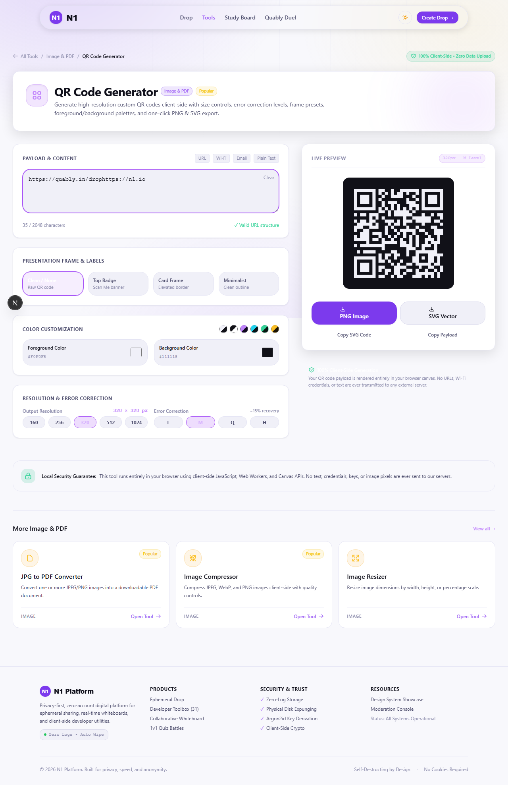
        <br/><strong>QR Code Generator & Scanner</strong>
      </td>
      <td width="25%" align="center">
        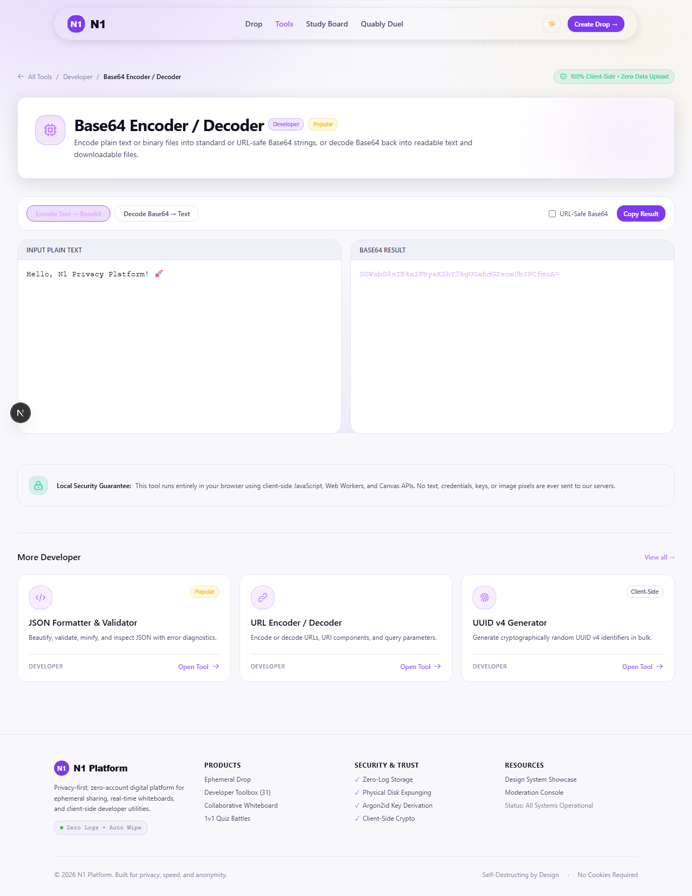
        <br/><strong>Base64 String & File Encoder</strong>
      </td>
      <td width="25%" align="center">
        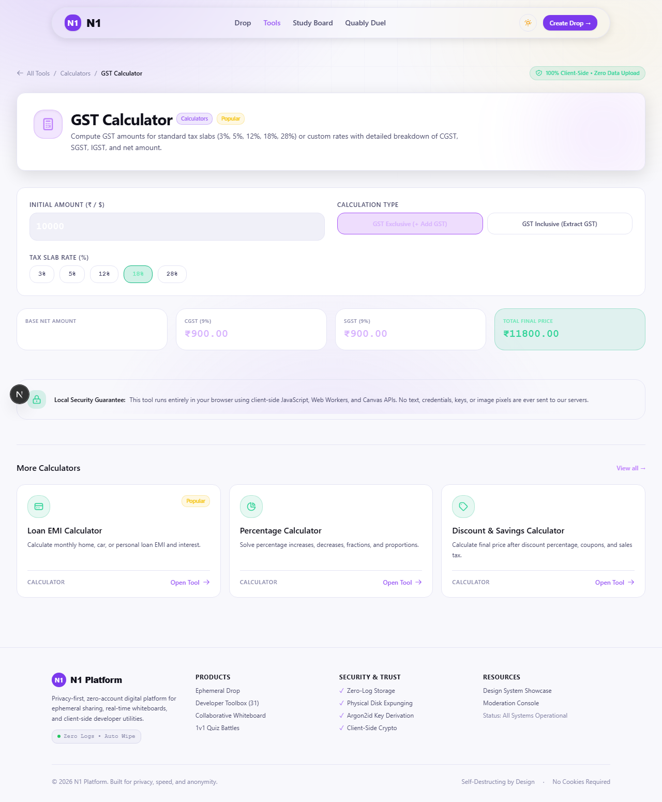
        <br/><strong>Indian GST Tax Calculator</strong>
      </td>
    </tr>
  </table>
</div>

#### Available Tool Categories:
- **Data & Code (8 Tools):** JSON Formatter/Validator, JSON ↔ CSV Converter, JSON ↔ YAML Converter, Base64 Encoder/Decoder, URL Encoder/Decoder, JWT Token Inspector, HTML Entity Encoder, SQL Formatter.
- **Text & Content (7 Tools):** Regex Tester & Debugger, Live Markdown Editor & HTML Exporter, Word & Character Counter, Text Diff Comparator, Slug Generator, Case Converter (camelCase, snake_case, kebab-case), Lorem Ipsum Generator.
- **Security & Cryptography (5 Tools):** Hash Generator (MD5, SHA-1, SHA-256, SHA-512), UUID v4 Generator, Cryptographic Password Generator, HMAC Signature Generator, Unix Timestamp Converter.
- **Media & Images (6 Tools):** Image Compressor (lossy/lossless), Image Resizer & Scaler, Image Format Converter (PNG, JPEG, WebP), SVG to PNG Renderer, PDF Page Counter, Color Palette Generator.
- **Calculators & Units (5 Tools):** Indian GST Calculator (CGST, SGST, IGST), Aspect Ratio Calculator, Color Code Converter (HEX, RGB, HSL), Unit Converter, High-Contrast QR Code Generator.

---

### 5. Admin & Moderation Console

Accessible at `/admin` for privacy-respecting platform observability and automated abuse mitigation.

<div align="center">
  <table width="100%">
    <tr>
      <td width="50%" align="center">
        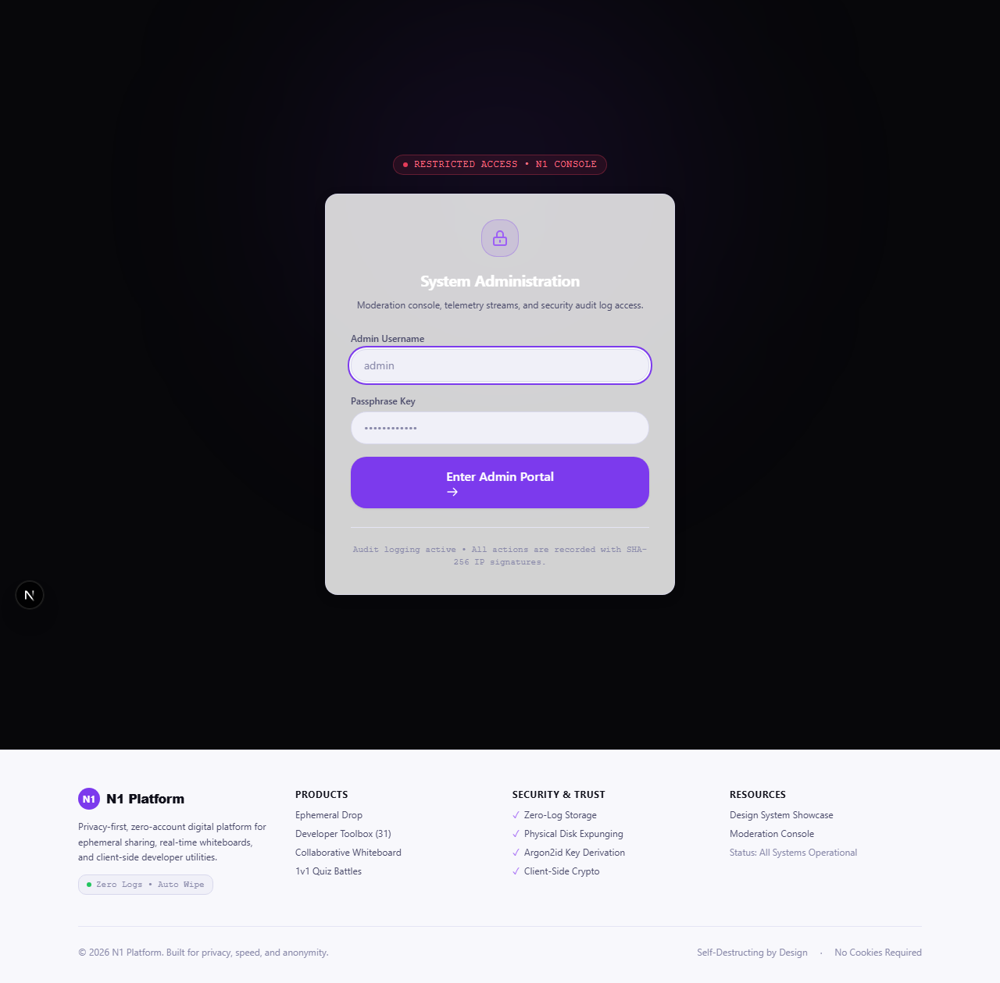
        <br/><strong>Secure Admin Authentication</strong>
      </td>
      <td width="50%" align="center">
        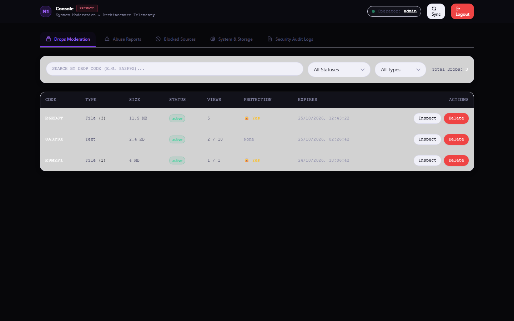
        <br/><strong>Live Telemetry & Abuse Moderation</strong>
      </td>
    </tr>
  </table>
</div>

- **Anonymous Abuse Queue:** Visitors can flag malicious or infringing drops. Reports are queued for one-click admin review and purge.
- **Instant Drop Expunging:** Instantly purges illegal content and deletes physical files from server storage.
- **Salted SHA-256 IP Blocking:** Blocks repeat malicious actors without storing raw, identifiable IP addresses.
- **Live Platform Telemetry:** Real-time server health, active WebSocket connections, memory utilization, disk consumption, and drop counts.

---

### 6. Design System & Accessibility

Built using a custom **Cyber-Minimalist Dark Theme** with violet-indigo fluorescent accents, high WCAG contrast ratios, and native responsiveness.

<div align="center">
  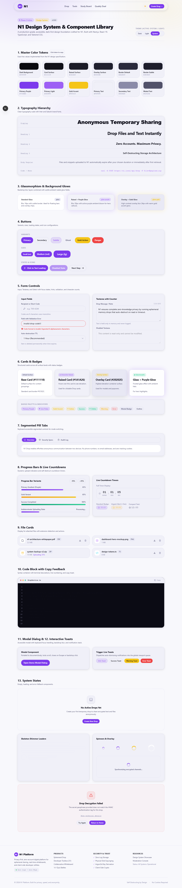
  <p><em>The N1 design system showcase (`/design-system`) demonstrating tokens, badges, typography, cards, and modal components.</em></p>
</div>

---

## 🔒 Deep Defense Security Architecture

```
Incoming Request
      │
      ▼
┌────────────────────────────────────────────────────────┐
│ 1. Helmet Security Headers (Strict CSP, HSTS, X-Frame) │
└─────────────────────────┬──────────────────────────────┘
                          │
                          ▼
┌────────────────────────────────────────────────────────┐
│ 2. Salted SHA-256 IP Hasher & Tiered Rate Limiters     │
└─────────────────────────┬──────────────────────────────┘
                          │
                          ▼
┌────────────────────────────────────────────────────────┐
│ 3. NoSQL Injection Stripper (Sanitizes Mongo operators)│
└─────────────────────────┬──────────────────────────────┘
                          │
                          ▼
┌────────────────────────────────────────────────────────┐
│ 4. Magic Byte Binary Inspector (First 512 bytes on disk)│
└─────────────────────────┬──────────────────────────────┘
                          │
                          ▼
┌────────────────────────────────────────────────────────┐
│ 5. Partitioned Storage Isolation (storage/drops/YYYY-MM)│
└────────────────────────────────────────────────────────┘
```

- **Magic Byte Signature Inspection:** Validates binary file headers (first 512 bytes) on disk before allowing downloads, rejecting disguised executables (`.exe`, `.bat`, `.sh`, `.elf`) attempting to masquerade as innocent images or documents.
- **MIME & Extension Whitelisting:** Strict two-stage check against dangerous file types.
- **Path Traversal Guards:** File names are sanitized and forced into partitioned directories (`storage/drops/YYYY-MM/{uuid}.{ext}`). Absolute paths and directory traversal (`../`) are systematically rejected.
- **NoSQL Injection Sanitizer:** Middleware recursively strips MongoDB query operators (`$gt`, `$ne`, `$where`, `$regex`) and dot notation from all incoming JSON payloads.
- **Salted SHA-256 IP Hashing:** Platform rate-limiters and abuse tracking hash client IP addresses using a server-side salt. Raw user IP addresses are **never written to the database**.
- **Hardened HTTP Headers:** Helmet configured with strict Content Security Policy (CSP), `X-Content-Type-Options: nosniff`, `frameguard: deny`, and strict CORS policies.

---

## 🛠️ Technology Stack

```
Frontend:    Next.js 15.5 (App Router) + React 19 + TypeScript 5.8 + Tailwind CSS 3.4
Backend:     Node.js 22 + Express 4.21 + TypeScript + WebSockets (ws 8.18)
Database:    MongoDB Atlas (Mongoose 8.10) with automatic TTL indexing
Storage:     Abstracted StorageService (Local container disk / S3 & R2 compatible)
Validation:  Zod 3.24 (Unified monorepo validation schemas)
Security:    Argon2id + Helmet + Crypto + Magic Byte Signature Inspection
Testing:     Vitest 3 + Supertest + Playwright (273 Automated Tests Passed)
Deployment:  Vercel (Frontend) + Render.com (Backend API & WS) + MongoDB Atlas (Database)
```

---

## 📁 Monorepo Structure

```
PROJECT_N1/
├── apps/
│   ├── web/                         # Next.js 15 Frontend Application
│   │   ├── src/app/                 # App Router (/drop, /board, /duel, /tools, /admin)
│   │   ├── src/components/          # UI Components, Canvas Whiteboard, Tools, Modals
│   │   ├── src/lib/                 # API Client, Board & Duel WebSocket clients
│   │   └── tailwind.config.ts       # Design system tokens, typography, and palette
│   │
│   └── api/                         # Express Backend API & WebSocket Engine
│       ├── src/config/              # Environment, Database, and Rate Limit configurations
│       ├── src/controllers/         # Request handling and orchestrations
│       ├── src/database/            # Mongoose schemas, TTL indexes, and connection
│       ├── src/middlewares/         # Security, validation, and error handlers
│       ├── src/routes/              # REST Endpoints (/api/drop, /api/board, /api/duel, /api/admin)
│       ├── src/security/            # Magic-byte check, token signing, password hashing
│       ├── src/services/            # DropService, ExpirationService, StorageService
│       └── src/websocket/           # Board & Duel WebSocket servers
│
├── packages/
│   ├── shared/                      # Shared types, enums, constants, and interfaces
│   ├── config/                      # Server defaults and design system tokens
│   └── validation/                  # Zod validation schemas across full stack
│
├── docs/screenshots/                # High-resolution platform showcase screenshots
├── DEPLOYMENT_GUIDE.md              # Zero-cost production deployment blueprint
├── render.yaml                      # Blueprint configuration for Render.com
├── vercel.json                      # Build & output configuration for Vercel
├── pnpm-workspace.yaml              # PNPM workspace definition
└── package.json                     # Monorepo build, lint, and test scripts
```

---

## 🚀 Getting Started (Local Development)

### Prerequisites

- **Node.js:** v20.0.0 or higher
- **PNPM:** v9.0.0 or higher (`npm install -g pnpm`)
- **MongoDB:** Local MongoDB instance running on `localhost:27017` (or MongoDB Atlas free cluster URI)

### Quick Setup

1. **Clone the repository:**
   ```bash
   git clone https://github.com/Thanniru-yaswanth03/N1.git
   cd N1
   ```

2. **Install all dependencies:**
   ```bash
   pnpm install
   ```

3. **Configure Environment Variables:**
   Copy `.env.example` to `.env`:
   ```bash
   cp .env.example .env
   ```
   *(All defaults in `.env.example` are pre-configured to run out of the box at ₹0 cost!)*

4. **Start Development Servers:**
   - **Terminal 1 (Backend API & WebSockets):**
     ```bash
     pnpm dev:api
     ```
     *API starts at `http://localhost:5000` (Health check: `/health`).*

   - **Terminal 2 (Next.js Frontend):**
     ```bash
     pnpm dev:web
     ```
     *Frontend opens at `http://localhost:3000`.*

---

## 🧪 Running Automated Tests

The codebase includes comprehensive unit, integration, and security test suites covering all packages:

```bash
# Run TypeScript compilation checks across all 6 packages
pnpm typecheck

# Run all 273 automated tests (35 web, 238 API)
pnpm test

# Build production bundles for all packages and applications
pnpm build
```

---

## 🌐 Zero-Cost Production Deployment

Deploy the entire platform with **₹0 / $0 monthly cost** using **Vercel** + **Render** + **MongoDB Atlas**:

```
┌───────────────────────────────┐        ┌───────────────────────────────┐
│     Vercel (Free Tier)        │        │     Render.com (Free Tier)    │
│  Next.js 15 Frontend (@n1/web)│◄──────►│ Express API & WS (@n1/api)    │
│  https://n1-pi-eight.vercel.app│       │  https://n1-api.onrender.com  │
└───────────────────────────────┘        └───────────────┬───────────────┘
                                                         │
                                         ┌───────────────▼───────────────┐
                                         │  MongoDB Atlas (M0 Free Tier) │
                                         │   512 MB Free Cluster (No CC) │
                                         └───────────────────────────────┘
```

### Verified Live Production Endpoints:
- **Frontend App:** [https://n1-pi-eight.vercel.app](https://n1-pi-eight.vercel.app)
- **Backend API & WebSockets:** [https://n1-api.onrender.com](https://n1-api.onrender.com)
- **API Health Check:** [https://n1-api.onrender.com/health](https://n1-api.onrender.com/health)

*(For step-by-step zero-cost deployment instructions, see [DEPLOYMENT_GUIDE.md](DEPLOYMENT_GUIDE.md)).*

---

## 📚 Documentation Index

- [DEPLOYMENT_GUIDE.md](DEPLOYMENT_GUIDE.md) — Step-by-step free deployment blueprint for Vercel, Render, and MongoDB Atlas.
- [ARCHITECTURE.md](ARCHITECTURE.md) — System design, data flows, storage abstraction, and worker engine.
- [PRODUCT_SPEC.md](PRODUCT_SPEC.md) — Comprehensive product specifications, UI/UX requirements, and module rules.
- [SECURITY.md](SECURITY.md) — Threat model, defense-in-depth security, file validation, and cryptographic standards.
- [API_SPEC.md](API_SPEC.md) — REST API endpoints, schemas, parameters, and error envelopes.
- [DEVELOPMENT_PLAN.md](DEVELOPMENT_PLAN.md) — Phased implementation plan, test coverage targets, and verification gates.

---

## 📄 License

This project is open-source under the **[MIT License](LICENSE)**. Built for absolute privacy, high performance, and zero platform exploitation.
