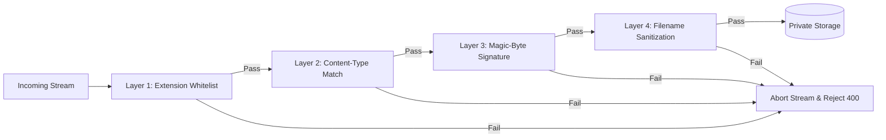

# N1 — Security Architecture & Threat Model

> **Status:** Approved Security Specification  
> **Classification:** Production Defense-in-Depth Protocol  
> **Budget Constraint:** ₹0 (All controls implemented via open-source tools & algorithms)

---

## 1. Threat Model & Attack Vector Analysis

Because N1 allows anonymous file and text uploads without accounts, it is subject to hostile threat vectors. The system is hardened against six primary threat classes:

```
┌────────────────────────────────────────────────────────────────────────┐
│                        Threat Landscape Matrix                         │
├─────────────────────────┬──────────────────────────────────────────────┤
│ Threat Vector           │ Potential Impact                             │
├─────────────────────────┼──────────────────────────────────────────────┤
│ 1. Malicious File       │ Remote Code Execution (RCE), Stored XSS,     │
│    Execution / Polyglot │ Web Shell Upload disguised as harmless image │
├─────────────────────────┼──────────────────────────────────────────────┤
│ 2. Path Traversal       │ Arbitrary host file read / system file       │
│                         │ overwriting via ../ or null bytes            │
├─────────────────────────┼──────────────────────────────────────────────┤
│ 3. Denial of Service /  │ Server disk exhaustion, Out-of-Memory crash, │
│    Storage Flooding     │ ZIP bomb decompressive expansion             │
├─────────────────────────┼──────────────────────────────────────────────┤
│ 4. Short Code           │ Unauthorized reconnaissance and harvesting   │
│    Enumeration          │ of private temporary drops via brute force   │
├─────────────────────────┼──────────────────────────────────────────────┤
│ 5. Password Cracking /  │ Cracking passphrase on protected drops via   │
│    Timing Attacks       │ dictionary attacks or timing side-channels   │
├─────────────────────────┼──────────────────────────────────────────────┤
│ 6. Storage Leakage      │ Data retained after expiry, violating        │
│                         │ core privacy promises and exhausting disk    │
└─────────────────────────┴──────────────────────────────────────────────┘
```

---

## 2. Multi-Layer File Validation Pipeline

To completely eliminate malicious uploads (e.g., PHP web shells named `exploit.pdf` or disguised SVGs with embedded `<script>` tags), every file passes through a mandatory 4-layer gate before reaching storage:



### Layer 1: Strict Extension Whitelist

Only explicitly permitted extensions are accepted:

```typescript
export const ALLOWED_EXTENSIONS = [
  'jpg',
  'jpeg',
  'png',
  'webp',
  'pdf',
  'doc',
  'docx',
  'xls',
  'xlsx',
  'ppt',
  'pptx',
  'txt',
  'zip',
] as const;
```

Any extension with double extensions (e.g., `image.png.php`, `file.pdf.exe`) is rejected at the parser level.

### Layer 2: Content-Type Header Verification

The multipart `Content-Type` header sent by the client browser is checked against an internal lookup table mapping allowed extensions to their canonical MIME types.

### Layer 3: Magic-Byte / File-Signature Inspection (The Gold Standard)

Attackers can effortlessly spoof file extensions and `Content-Type` headers. N1 inspects the first **4,100 bytes** of the actual incoming binary stream using `file-type`:

- The stream is paused after 4KB is buffered.
- The magic numbers (byte signatures) are evaluated:
  - JPEG: `FF D8 FF`
  - PNG: `89 50 4E 47 0D 0A 1A 0A`
  - PDF: `25 50 44 46` (`%PDF`)
  - ZIP/Office Docs (DOCX/XLSX/PPTX): `50 4B 03 04` (`PK..`)
- If the true binary signature contradicts the extension or is not on the whitelist, the connection is **immediately aborted** (`req.destroy()`), and the partially uploaded file is wiped from memory/temp space.

### Layer 4: Filename Sanitization & Synthetic Keying

- User-provided filenames are never used as physical storage paths.
- Storage keys are generated as isolated UUIDv4 / SHA-256 identifiers:
  ```
  storage/drops/{YEAR}-{MONTH}/{UUIDv4}.bin
  ```
- When downloaded, the original filename is sanitized using `slugify` (stripping non-ASCII, null bytes `\0`, directory slashes `/` and `\`, and reserved names like `CON`, `PRN`, `AUX` on Windows) before setting the `Content-Disposition` header.

---

## 3. Path Traversal & File Serving Protections

1. **Storage Isolation:** Files are written to a directory explicitly outside the web server's public root (`storage/` is not mounted by Express static middleware).
2. **Controlled Download Handlers:** All downloads pass through authenticated Express handlers (`/api/v1/drops/:code/download/:fileId`).
3. **No Direct Path Inputs:** Handlers look up the drop by its verified database ID and resolve the storage key internally. User input never touches `path.join()` or `path.resolve()`.
4. **Header Hardening on Downloads:**
   - `Content-Disposition: attachment; filename="sanitized.ext"`
   - `X-Content-Type-Options: nosniff` (forces browser to download rather than execute HTML/JS in browser context).
   - `Content-Security-Policy: default-src 'none'` for download endpoints.

---

## 4. Cryptographic Randomness & Entropy Specifications

### 4.1 Short Code Generation

- **Entropy Requirement:** Prevent brute-force scanning while keeping codes human-readable.
- **Charset:** Base62 (`0-9`, `a-z`, `A-Z`) or unambiguous 32-character set (`2-9`, `A-H`, `J-N`, `P-Z` avoiding `0/O/1/I`).
- **Length:** 6 characters.
- **Combinations:** $62^6 \approx 56,800,235,584$ (~56.8 billion possibilities).
- **Generation Method:** Node.js `crypto.randomBytes(6)` converted to charset indexing.
- **Rate Limiting Guard:** Max 10 code lookup requests per minute per IP. Brute-forcing a specific drop would require centuries of continuous queries.

### 4.2 Owner Deletion Token

- Generated via `crypto.randomBytes(32).toString('hex')`.
- Produces a 64-character hex string representing **256 bits of cryptographic entropy**.
- The raw deletion token is never displayed in public drop views. It is only accessible to the uploader's browser session.

---

## 5. Password Protection & Cryptographic Storage

- **Hashing Algorithm:** **Argon2id** (memory-hard, resistant to GPU/ASIC cracking).
  - Memory cost: 65,536 KB (64 MB)
  - Time cost / Iterations: 3
  - Parallelism: 4 threads
  - Salt: 16 bytes generated cryptographically per drop
- **Verification & Timing Attacks:**
  - Password verification utilizes `crypto.timingSafeEqual` over pre-computed hash buffers to prevent timing side-channel analysis.
- **Password Attempt Throttling:**
  - Maximum 5 incorrect passphrase attempts per 5 minutes per IP per drop. Exceeding this triggers a 429 Too Many Requests lockout.

---

## 6. HTTP Hardening & Middleware Protections

### Helmet Configuration

Express is hardened with Helmet applying strict security headers:

- **Strict-Transport-Security (HSTS):** `max-age=31536000; includeSubDomains; preload`
- **Content-Security-Policy (CSP):** Disallows arbitrary script injection, unsafe inline styles, and unauthorized frames.
- **X-Frame-Options:** `DENY` (prevents clickjacking attacks).
- **X-Content-Type-Options:** `nosniff`.
- **Referrer-Policy:** `strict-origin-when-cross-origin`.

### CORS Policy

- Backend API strictly restricts `Access-Control-Allow-Origin` to the verified frontend domain (`CLIENT_URL`).
- Disallows wildcards (`*`) when credentials or authorization headers are exchanged.

### Rate Limiting Hierarchy (`express-rate-limit`)

| Endpoint Pattern                     | Rate Limit Window | Max Requests | Purpose                             |
| :----------------------------------- | :---------------- | :----------- | :---------------------------------- |
| `ALL /api/v1/*`                      | 1 minute          | 120 reqs     | Prevent API flooding                |
| `POST /api/v1/drops`                 | 15 minutes        | 15 drops     | Prevent disk space exhaustion       |
| `POST /api/v1/drops/:code/unlock`    | 5 minutes         | 5 attempts   | Prevent password dictionary attacks |
| `GET /api/v1/drops/:code`            | 1 minute          | 30 requests  | Prevent code brute-forcing          |
| `GET /api/v1/drops/:code/download/*` | 1 minute          | 20 downloads | Prevent bandwidth exhaustion        |

---

## 7. Zero-Knowledge & Privacy Architecture

- **No Plaintext IP Storage:** User IP addresses are never persisted to the database. For rate-limiting purposes, IPs are temporarily hashed with a daily rotating salt in volatile memory and purged automatically.
- **Zero Tracking:** No analytics libraries (Google Analytics, Mixpanel, etc.), no marketing cookies, no fingerprinting scripts.
- **Tombstone Sanitization:** When a Drop expires, its text content and file binaries are irreversibly deleted from disk. Only the hash of the short code and the expiration timestamp remain for a 24-hour grace window to show the expired state before complete purging.
